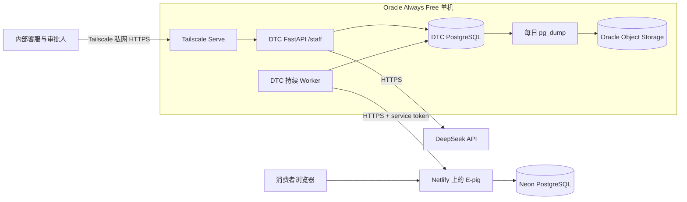

# 11 · 部署与运维

> 2026-11-07 已确认生产受控试点拓扑：E-pig 继续使用 Netlify + Neon，DTC 使用 Oracle Always Free 单机上的 API、持续 Worker 和 PostgreSQL，员工入口只通过 Tailscale 私网访问。该方案尚未部署；Oracle 登录风控、生产配置实现和 Netlify 生产路由仍是上线前阻塞项。

## 本章目录

1. [生产试点方案](#生产试点方案)
2. [本地](#本地)
3. [Docker Compose](#docker-compose)
4. [通用生产检查清单](#通用生产检查清单)
5. [扩容、知识库、回滚](#扩容知识库回滚)

## 生产试点方案

### 决定与适用边界

截至 2026-11-07，采用下面的受控试点方案。它是部署方案，不是已部署环境；只有完成本文“上线闸门”并保留实际运行证据后，才能称为部署或生产验收。



文字说明：消费者继续访问 E-pig；E-pig 的页面、Route Handlers 与业务数据仍由 Netlify 和 Neon 承载。内部员工通过 Tailscale 访问同机运行的 DTC 页面与 API。Worker 通过 HTTPS 查询 E-pig feed 并提交已人工批准的操作。DTC API 和 PostgreSQL 不开放公网端口，备份写入 Oracle Object Storage。

选择该方案的原因：

- DTC 当前是 Python ASGI 服务和持续轮询的独立 Worker。Netlify Functions 不是当前 Python 代码和常驻 Worker 的直接运行环境；改成全 Netlify 会变成后端与 Worker 重写，不只是部署迁移。
- E-pig 已在 Netlify 上有可访问页面和 Neon 数据，迁移到 Oracle 不产生业务收益，反而增加域名、数据库迁移、Next.js 运行和回滚风险。
- DTC 的资源需求适合一台 VM 上的 Compose。Oracle Always Free 可以按纯免费目标先做受控试点，但必须先核实账户资格、区域和配额，不能把“免费”当成已获批资源。
- Tailscale 私网比公网 API 更适合内部客服和审批入口。它缩小暴露面，也避免在没有 SSO 和完整运维监控时把 DTC 直接发布到互联网。

| 选项 | 结论 | 主要理由 | 改变决定的条件 |
|---|---|---|---|
| E-pig 保持 Netlify + Neon | 采用 | 已有站点和运行时；消费者入口无需重写 | Netlify 额度、函数限制或业务存储不再满足实测负载 |
| DTC 放 Oracle 单机 + 本机 PostgreSQL | 采用 | Python/Worker 可直接运行；免费目标最直接；单机故障域可接受于内部试点 | 需要高可用、生产 SLA、跨区容灾或本机容量不足 |
| 全部迁到 Oracle | 不采用 | 需要迁移已工作的 E-pig 和 Neon，增加无业务收益的变更 | E-pig 在 Netlify 出现不可接受限制，且完成独立迁移/恢复设计 |
| 全部使用 Netlify | 不采用 | 当前 DTC Python ASGI 与常驻 Worker 需要重写 | DTC 后端与 Worker 另立迁移项目，并通过等价恢复验收 |
| Cloudflare Tunnel 替代 Tailscale | 暂不采用 | 当前内部用户少，Tailscale 权限边界更直接 | 需要自有域名、统一 Zero Trust 策略或多组织访问 |

官方约束入口：[Netlify Functions](https://docs.netlify.com/build/functions/overview/)、[Netlify 定价与额度](https://www.netlify.com/pricing/)、[Oracle Always Free Resources](https://docs.oracle.com/en-us/iaas/Content/FreeTier/freetier_topic-Always_Free_Resources.htm)。报价和免费额度会变化，采购前以当时控制台为准。

### 当前事实

- Netlify 项目为 `e-pig-au-sandbox`，站点地址为 `https://e-pig-au-sandbox.netlify.app/`。2026-11-07 查到的生产部署来自 `main`，生产售后接口仍为 404；分支 Deploy Preview 已有售后 Route Handler。
- Preview 在缺少契约版本时返回 `400 UNSUPPORTED_CONTRACT_VERSION`；带正确契约版本但没有 service token 时曾返回 `500 INTERNAL_ERROR`，预期是 `401 UNAUTHORIZED`。这说明 token 配置或错误映射至少有一项尚未通过入口验收。
- DTC 已有锁定依赖的镜像、独立售后 Compose、显式 Alembic 迁移、持续 Worker、`/api/v1/health`、`/api/v1/ready` 和内部 `/metrics`；这些只在本地/隔离合成环境验证过。
- DTC 的 `docker-compose.after-sales.yml` 是 development + Fake + loopback 演示入口，不能直接当生产配置。
- 生产 Compose、Tailscale 入口、生产配置预检、PostgreSQL 员工凭证 CLI、备份调度、告警和回滚脚本尚未实现。
- Oracle CLI 与 MCP 注册已安装，但本机没有 `~/.oci/config`；最近一次登录停在风控/注册页面。该事实只表示认证未完成，不能推断租户、主区域、免费配额或 VM 可用。

### 上线前准备清单

以下项目按顺序关闭。除特别说明外，不使用真实客户数据，不执行外部退款、取消或未经审批的业务写入。

| 编号 | 上线前必须完成 | 可观察证据 | 当前状态 |
|---|---|---|---|
| P0 | 确认 Oracle 账户、租户、主区域、MFA 和 Always Free 配额；解决登录风控 | 控制台与 OCI CLI 使用同一租户；记录区域、compartment、可用配额；不在本机留下不属于该租户的配置 | 阻塞，认证未完成 |
| P1 | 固定 E-pig 可发布提交，补齐 Netlify production 环境变量并应用 Neon 迁移 | Deploy Preview 和 production candidate 均能返回 `200`；缺失/错误 token 返回 `401`；生产域名不再命中 404 | 未通过 |
| P2 | 实现并审查 DTC 生产 Compose、Tailscale 入口、配置预检和 CI 镜像构建 | 容器按 `uv.lock` 构建；非 root；迁移先成功；API/Worker 安全重启；配置负例全部拒绝 | 未实现 |
| P3 | 实现 PostgreSQL 员工凭证 create/rotate/disable | token 只写新建 `0600` 文件；rotate 后旧 token 下一次请求失效；disable 立即拒绝；demo login 在 production 拒绝启动 | 未实现 |
| P4 | 定义机器权限、私网和端口边界 | OCI 安全列表不开放 API/DB 公网端口；Tailscale ACL 只允许指定员工；`/metrics` 不走员工入口；主机 SSH 仅受控来源 | 未配置 |
| P5 | 配置 secret 与配置模板 | 生产 env 为 `0600` 或更严格；数据库/E-pig/DeepSeek/Admin secret 不进入 Git、镜像、日志或命令输出；E-pig service token 可轮换 | 未配置 |
| P6 | 建立 DTC 备份、保留、恢复和 E-pig/Neon 备份责任 | DTC 每日 `pg_dump --format=custom` 到加密对象存储；保留 7 份日备份 + 4 份周备份；恢复演练可在新库核对审批、草稿、游标、幂等键和回执 | 仅完成一次隔离恢复验证，未配置生产调度 |
| P7 | 确定监控与告警接收人 | `/ready`、Worker 心跳/最近周期、数据库连接、磁盘、备份年龄有检查；告警能在不暴露客户资料和 token 的渠道送达 | 未配置 |
| P8 | 固定发布、升级、回滚和紧急停用顺序 | 先暂停 Worker 和写入，再评估数据库/镜像回滚；数据库不盲目 downgrade；保留命令和演练记录 | 方案已定义，未演练 |

### 上线闸门

任何一项失败都保持“不发布”。闸门按顺序执行，避免把局部成功合并成整体通过：

1. **源码与配置冻结**：DTC 和 E-pig 使用明确提交；生产 env、Tailscale ACL、E-pig token、SKU 映射和允许市场可回读；固定密码演示登录关闭。
2. **E-pig 契约入口**：有效 service token + 正确契约版本返回成功；错误/缺失 token 必须稳定返回 `401`；错误契约版本返回 `400`；不存在的资源返回契约约定的 `404`。
3. **DTC 工程门禁**：完整测试、静态检查、真实 PostgreSQL 测试、锁文件检查、容器构建和敏感信息扫描通过；生产配置预检的每个负例都拒绝启动。
4. **数据库闸门**：在全新 PostgreSQL 执行迁移到 head；再在旧版本副本执行升级；API/Worker 只有在 migrate 成功后才启动。
5. **网络闸门**：从公网无法连接 DTC API/PostgreSQL；未授权 Tailscale 设备无法访问；员工入口和 API 可用；`/metrics` 只允许受控来源。
6. **恢复闸门**：停止 Worker，备份，恢复到全新数据库，核对迁移版本、案例、草稿、审批、游标、operation key/payload 和外部回执；恢复后不重复创建工单。
7. **端到端闸门**：使用专用 service token 和合成订单完成消费者提交、员工同步、草稿、人工审批、唯一工单、唯一回复；不需要人工修复脚本。
8. **运维闸门**：Worker 连续运行并能在重启后继续；日志轮转、磁盘空间、备份年龄和告警有效；紧急停用能在一轮内停止领取新操作。

### 未来部署顺序（本次不执行）

1. 解决 Oracle 账户风控并核实免费资源；在此之前不改代码依赖云控制台行为。
2. 通过 Claude 实现、Codex Review 和安全验收完成 P2～P3；外部付费、真实数据和生产部署仍需实际授权。
3. 合并 E-pig 已验收提交到可发布分支，配置 Netlify production 环境和 Neon 迁移，先关闭 P1。
4. 创建专用 VM、加密块存储和对象存储桶；安装最小系统、Docker/Compose、Tailscale；禁止公网 API/DB 入站。
5. 写入生产 secret 和员工 token，配置 E-pig service token，执行配置预检。
6. 先迁移并做恢复演练，再启动 API 和 Worker；用 `/ready`、内部指标和一次合成业务完成闸门 5～8。
7. 只开放小范围内部试用。真实客户、自动退款、自动取消、主分支发布和高可用承诺不属于本次试点。

### 失败与回滚

- E-pig 入口异常时，先暂停 DTC Worker，保留 token 与请求证据，不通过关 TLS、放宽契约或改数据库状态绕过。
- DTC API 异常时，回退到上一个已验收镜像；Worker 继续停止。数据库迁移是否兼容由具体 migration 决定，不能默认镜像回滚而数据库仍可安全回退。
- 数据损坏或迁移不兼容时，恢复到新的 PostgreSQL 实例，以恢复前的 operation key/payload 查询 E-pig 回执；禁止换新键重复提交。
- 员工凭证泄露时立即 rotate；需要停止某员工时 disable；需要全局止血时暂停 Worker、阻断 Tailscale 入口并轮换 E-pig service token。
- 恢复或回滚不会撤销 E-pig 已经提交的工单。外部结果未知时仍进入人工对账。

## 本地

SQLite + 内存向量，见 [02](02-getting-started.md)。

## Docker Compose

```bash
docker compose up --build -d
```

启动后访问 `http://127.0.0.1:8000`，停止服务使用 `docker compose down`。数据保存在 Compose volume `adaptive-rag-data` 中。

### 三种运行模式

| 模式 | Compose 文件 | 组件 | 适用场景 |
|---|---|---|---|
| 默认演示 | `docker-compose.yml` | API、前端、SQLite | 最少依赖，自动降级 |
| 单机生产 | `docker-compose.single.yml` | API、前端、PostgreSQL、Redis | 单节点长期运行 |
| 多实例生产 | `docker-compose.multi.yml` | Nginx、双 API、PostgreSQL、Redis、Qdrant | 扩容和共享状态 |

```bash
# 单机和多实例模式先设置数据库密码
export POSTGRES_PASSWORD='change-this-password'
docker compose -f docker-compose.single.yml up --build -d
docker compose -f docker-compose.multi.yml up --build -d
```

单机和多实例镜像会安装 `.[rerank]`。启用本地 Embedding / Cross-Encoder 时，首次启动可能下载模型；没有 LLM 密钥时仍会使用离线证据回答。

| 容器 | 作用 | API 依赖 |
|---|---|---|
| `api` | FastAPI | 8000 |

### 代码摘要

```yaml
# docker-compose.yml
api:
  environment:
    DATABASE_URL: sqlite+aiosqlite:///./data/local/app.db
    REDIS_URL: ""
    QDRANT_URL: ""
    APP_ENV: production
```

健康检查打 `http://127.0.0.1:8000/api/v1/health`。镜像非root，按`uv.lock`执行frozen依赖安装，应用通过`/app`的PYTHONPATH运行，包含显式Alembic迁移。

## 通用生产检查清单

本节保留上游通用检查，不能替代上面的试点闸门。

- [ ] `APP_ENV=production`，`LOG_LEVEL=INFO`
- [ ] `ADMIN_API_TOKEN` 已设
- [ ] `DATABASE_URL` 指向 Postgres，连接池已看过
- [ ] 真实 embedding 网关（否则对外以 BM25 为准）
- [ ] `pip install -e ".[rerank]"` 后重跑 retrieval，报告含 `hybrid+cross-encoder`
- [ ] `pip install -e ".[docs]"` 后用真实 PDF/扫描件验证 ingest；换切分后重跑 `--task retrieval`
- [x] `u_demo` / `anonymous` 全局读单已关闭
- [ ] 售后启用员工Bearer并核对角色/市场配置；旧演示模式不能代替生产认证，不可直接对公网开放
- [ ] liveness / readiness 分开（见 [08](08-reliability.md#探活)）
- [ ] 密钥不在日志、镜像、README
- [ ] 生产目标按显式Alembic执行升级并演练恢复；售后PG入口已提供迁移gate，旧SQLite演示的create_all不适用于PG

## 扩容、知识库、回滚

API 无粘滞：session 在 DB。进程内限流多副本不共享 → 生产配 Redis。Graph 每进程编译一次。

改 `knowledge/` 文档后重启 API。`chunk_id` 在同一切分结果下稳定，Qdrant upsert 覆盖。无 CMS。生产 ingest 走 Unstructured；系统包需要 poppler、tesseract（`chi_sim`）、处理 Office 时的 libreoffice。换解析器后重跑 `--task retrieval`。

应用无状态（除 DB）。回滚镜像即可。Alembic `0002` 退货表，schema 回滚需显式 `downgrade`。

---

上一章 [10](10-evaluation.md) · 下一章 [12 · 限制](12-limitations.md)


## 售后隔离部署候选

`docker-compose.after-sales.yml`为本地合成环境入口，不替换旧Compose；API仅绑定127.0.0.1，PG不发布主机端口。migrate先等PG健康，API/Worker再等迁移成功。镜像保留production及禁用本地模型的安全默认，本地Compose显式覆盖development/Fake/离线；bridge允许出站，不能宣称网络层禁止外联。空admin token在development下允许本地管理信息访问，员工业务接口仍要求真实员工身份。

首次操作须选全新且明确归属的项目名，准备外部生成的合成PG密码，并使用`--env-file /dev/null`或本次0600专用文件，避免Compose自动读取仓库.env。不要在已有业务库运行本演示。镜像依uv.lock frozen安装并包含Alembic配置/0005；`NODE_IMAGE`/`PYTHON_IMAGE`构建参数可指定相同官方版本的可达镜像源，不改变Python依赖。IMAGE_REVISION只表示构建基线，有工作区叠加时还需记录候选文件digest和实际image ID。

API与Worker各自Fake不能共享外部工单，因此健康/迁移/Worker单次成功只证明部署基础。真实两仓HTTP、员工初始化、备份恢复另验；当前员工SQLite seed不适用于PG，不能把它用于已有PG库。基础启动与清理示例见下文，真实业务初始化与两仓恢复仍另验。

以下操作仅启动新的本地部署基础环境。在同一终端保留变量用于清理；API自动分配loopback端口，避免占用已有服务。凭据文件不输出到终端、不进入构建上下文：

```bash
DTC_DEMO_PROJECT="dtc-demo-$(python3 -c 'import secrets; print(secrets.token_hex(6))')"
DTC_DEMO_ENV="$(mktemp -t dtc-after-sales)"
chmod 600 "$DTC_DEMO_ENV"
python3 - "$DTC_DEMO_ENV" "$DTC_DEMO_PROJECT" <<'PY'
import secrets, sys
from pathlib import Path
Path(sys.argv[1]).write_text(
    'POSTGRES_PASSWORD=' + secrets.token_hex(24) + '\n'
    + 'POSTGRES_USER=dtc\nPOSTGRES_DB=dtc_after_sales\nAPI_PORT=0\n'
    + 'APP_IMAGE=' + sys.argv[2] + ':local\n'
)
PY

docker compose --env-file "$DTC_DEMO_ENV" -f docker-compose.after-sales.yml \
  -p "$DTC_DEMO_PROJECT" build
# 若Docker Hub不可达，可在上述build后追加已实测的相同官方版本构建参数：
# --build-arg NODE_IMAGE=public.ecr.aws/docker/library/node:24-alpine \
# --build-arg PYTHON_IMAGE=public.ecr.aws/docker/library/python:3.11-slim

docker compose --env-file "$DTC_DEMO_ENV" -f docker-compose.after-sales.yml \
  -p "$DTC_DEMO_PROJECT" up -d --no-build

docker compose --env-file "$DTC_DEMO_ENV" -f docker-compose.after-sales.yml \
  -p "$DTC_DEMO_PROJECT" ps -a

docker compose --env-file "$DTC_DEMO_ENV" -f docker-compose.after-sales.yml \
  -p "$DTC_DEMO_PROJECT" port api 8000
```

按输出的`127.0.0.1:端口`访问`/api/v1/health`、`/api/v1/ready`和`/staff`。预期migrate退出0、API健康、Worker运行，数据库版本0005；员工业务无token仍401。此步骤只提供登录shell，尚未初始化PG员工或接真实E-pig，不能据此宣布工作台业务演示完成。不要运行输出全部展开环境变量的`compose config`或全量容器inspect。

### 本地 SQLite 合成工作台登录

隔离开发/测试环境可显式启用固定演示密码，页面`/staff`会自动显示合成员工选择和密码输入框。该模式必须同时配置`AFTER_SALES_DEMO_LOGIN_ENABLED=true`、至少8字符的`AFTER_SALES_DEMO_PASSWORD`和至少32字符的`AFTER_SALES_DEMO_SESSION_SECRET`；密码通过`POST /api/v1/after-sales/demo-login`换取短时签名会话，不会直接作为Bearer发送业务请求。生产环境启用会拒绝Settings加载。

固定密码只用于本地合成演示。员工身份仍来自`after_sales_staff`，每次业务请求重新检查启用状态、到期时间、角色和市场；不要把同一个密码用于真实账号、共享部署或公网入口。登录选项、错误密码、篡改/过期会话、固定密码直连及禁权后的即时失效由认证测试覆盖，操作结果见[流程记录](records/after-sales/dtc-workflow.md)。

只清理本次随机项目，`-v`会删除该项目的合成PG数据，不要替换成既有项目名：

```bash
docker compose --env-file "$DTC_DEMO_ENV" -f docker-compose.after-sales.yml \
  -p "$DTC_DEMO_PROJECT" down -v --remove-orphans
docker image rm "$DTC_DEMO_PROJECT:local"
rm "$DTC_DEMO_ENV"
```

## 两仓隔离启动

需要验证DTC确实连接E-pig时，使用`docker-compose.after-sales-demo.yml`。准备器只归档两个明确提交，排除工作区与凭据；运行目录0700，专用配置0600，配置在构建上下文之外。E-pig Dockerfile受控副本仅补工作区依赖复制和官方基础镜像参数，摘要写入manifest，原仓库不修改。

在仓库根目录执行，SHA必须替换为计划演示的完整提交：

```bash
uv run python scripts/prepare_after_sales_demo.py prepare \
  --dtc-ref <DTC完整40位提交> \
  --epig-repo <E-pig本地仓库路径> \
  --epig-ref <E-pig完整40位提交>
```

按输出的专用`--env-file`、冻结Compose路径和随机项目名运行`up -d --build`，不要另用仓库.env。准备器支持`--dtc-node-image`、`--dtc-python-image`、`--epig-node-image`指定可达的同版本官方镜像。manifest包含版本、摘要、端口及清理归属，不要全文输出或上传。端口预选后仍可能被占用；失败时保留输出，清理本次项目并重新准备，不接管既有服务。

拓扑包含两个独立PG库、各自迁移、E-pig、DTC API与单次Worker。DTC共享E-pig网络命名空间，使既有Connector的开发环境loopback地址确实指向E-pig；不放宽生产HTTPS约束。仅E-pig容器发布两个127.0.0.1应用端口，数据库不发布端口。普通bridge仍允许出站，离线由明确配置保证。Worker此入口运行一次后应退出0；持续处理另需明确运行方式。

预期两个迁移退出0、两个PG健康、DTC ready200、无身份的员工业务401、Worker退出0。空库只验证启动，不含消费者订单、员工身份或完整建单；不要把空feed成功称为业务演示完成。完整业务及恢复证据见[流程记录](records/after-sales/dtc-workflow.md)。

清理只接受该次manifest：

```bash
uv run python scripts/prepare_after_sales_demo.py cleanup --manifest <输出的manifest路径>
```

它校验冻结Compose摘要和资源归属标签，确认所属容器、卷、网络消失后才删除配置和目录。遇到超时、标签不符或资源残留会保留配置供排查；不使用全局prune。镜像保留，可按manifest中本次镜像标签单独删除，不删除共享基础镜像。

## 售后数据库恢复的操作顺序

备份不能撤销已在E-pig提交的工单。DTC数据库恢复后，应先查询原幂等键的外部回执，避免重新创建。已验证的窗口是外部提交成功、DTC尚未收到回执；其他故障窗口需要单独验证。

1. 停止Worker并暂停DTC写入；确认数据库目标和备份权限。使用`pg_dump --format=custom`输出0600备份，禁止把连接密码写入命令历史或日志。
2. 在另一个明确归属的全新数据库恢复，先核对迁移版本0005、草稿、批准、游标及操作原键/payload；不要覆盖来源不明或正在使用的库，也不要同步回滚E-pig。
3. 保持Worker停止，连接恢复库启动API。对未完成操作等待租约自然到期，由授权操作员使用现有回执查询/对账入口核对原票据；回执关联不符或查不到时保留人工处理，不能伪造完成或换新键重发。
4. 确认原批准与草稿按核验结果消费、外部票据仍唯一，再恢复Worker；核对无重复外部POST。备份、恢复目标和原始日志按保留策略管理。

上述顺序在专用合成环境实际验证过，不提供生产RPO/RTO保证。现有临时验收工具没有作为通用备份平台交付；生产备份调度、异地存储、加密和恢复演练需要部署环境另行确定。

## 独立浏览器演示与验收

这条入口用合成订单和员工，在真实页面完成一次闭环，保留截图/报告后清理测试环境；不需要ChatGPT扩展或用户Chrome。它固定已验收的两个源码提交，不自动跟随分支HEAD，不是长期生产部署入口。前提是本仓Python开发依赖、Node24、前端锁定依赖，以及E-pig的Node/pnpm依赖已安装；Docker可用，固定提交在本地可读取。

首次使用由环境管理者建立本项目专用缓存，不要把用户Chrome目录当缓存或给其他目录补归属标记：

```bash
npm ci --prefix frontend
DTC_QA_ENGINE="$HOME/.cache/dtc-after-sales-browser/engine-playwright-1.65.0"
mkdir -p "$DTC_QA_ENGINE"
chmod 700 "$DTC_QA_ENGINE"
PLAYWRIGHT_BROWSERS_PATH="$DTC_QA_ENGINE" \
  node frontend/node_modules/playwright/cli.js install chromium
python3 - "$DTC_QA_ENGINE" <<'PY'
import os, sys
from pathlib import Path
marker = Path(sys.argv[1]) / '.dtc-owned'
marker.write_text('DTC dedicated synthetic browser acceptance cache\n')
os.chmod(marker, 0o600)
PY
```

浏览器下载失败应先排查环境，不关闭TLS校验、不回退用户浏览器。缓存可复用；若设置`DTC_BROWSER_RUN_ROOT`，安装位置也必须对应到该专用根下。

```bash
uv run python scripts/run_after_sales_browser.py --epig-repo /path/to/E-pig
```

预期四组分别验证：消费者申请到人工批准后的唯一工单回复；第二消费者隔离与未知提交原键恢复；员工冲突/角色/退出/AI不可用的手工处理；桌面和320px、关键键盘与错误/加载状态。动作通过DOM完成，之后用所属数据库独立核对唯一计数。正常故事创建的是经人工批准的`other`后续处理工单，不宣称通过退货资格或执行退款。

运行输出报告/截图路径和结果；配置与凭据保存在0700/0600目录并在结束删除。Node与独立Chromium分别记录精确进程归属，超时/取消也检查整组；清理失败保留失败状态，不因父进程退出宣称浏览器关闭。报告与截图仅含合成数据，仍应按本机证据保留策略管理。截图须人工检查，自动测试不是完整可访问性认证。

普通Python单测不需要Node或浏览器。真实浏览器在Node被杀后的清理故障验收必须单独启用；显式运行而缺引擎会失败，默认跳过不算通过：

```bash
DTC_RUN_BROWSER_FAULT_ACCEPTANCE=1 uv run pytest -q \
  tests/unit/test_after_sales_browser_runner.py::test_actual_detached_browser_group_is_cleaned_after_node_kill
```
