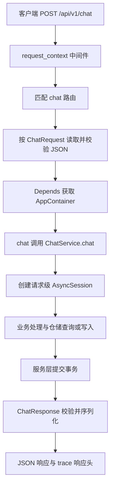

# 从一条售后请求学习 Python 后端基础

更新日期：2026-11-04。状态：依据当前源码与官方文档整理的学习说明；文中实验是操作建议，除明确标注外不代表已经执行。Demo 仅为下一步计划，尚未实现。

## 1. 这条学习路线解决什么问题

假设客服在工作台查询一个订单，后端收到：

```json
{
  "message": "查询订单 ORD10001",
  "user_id": "u_demo"
}
```

你已经有前端经验，熟悉“页面发请求 → 接口返回 JSON”。现在需要补的是服务端中间这段：谁匹配 URL，谁检查 JSON，为什么函数可以等待数据库，SQL 写在哪里，数据什么时候真正保存，又怎样用自动测试证明这些行为。

本文用同一条请求串起五项技术：

| 技术 | 白话职责 | 本项目例子 | 学完后你能做到 |
| --- | --- | --- | --- |
| FastAPI 路由、依赖注入 | 把 HTTP 请求交给正确的 Python 函数，并准备函数需要的对象 | `app/asgi.py`、`app/main.py`、`app/api/routes/chat.py` | 独立讲清请求从哪里来、经过哪里、到哪里去 |
| Pydantic Schema | 定义并检查输入输出的数据形状、类型和约束 | `app/schemas/chat.py` | 看懂必填、可空、默认值、长度约束和校验错误 |
| asyncio 异步 | 等待网络或数据库时，让事件循环有机会处理其他任务 | 路由、`ChatService`、异步仓储和 SSE | 看懂 `async def`、`await`、`async for`、`async with` |
| SQLAlchemy＋仓储模式 | 用 Python 模型和语句访问数据库；把数据访问细节从业务流程中隔离 | `app/repositories/` | 看懂模型、查询、`flush`、`commit` 和请求级 Session |
| pytest | 自动执行测试并报告断言失败 | `tests/` | 跑指定测试，写同步、异步和异常断言用例 |

建议按 **FastAPI → Pydantic → asyncio → SQLAlchemy → pytest** 阅读。前五节先建立整体图，之后每节只解决一类问题，最后再回到完整请求。

> 范围提醒：当前仓库包含上游对话、订单和售后工具实现；本 fork 的首期业务边界仍以[项目方案](../project-plan.md)为准。本文借现有代码讲技术，不表示真实身份认证、持久审批、Worker 或真实外部工单写入已经完成。

## 2. 先看全局：一次请求怎样进来又出去

### 2.1 启动与请求是两段不同生命周期

启动命令中的 `app.asgi:app` 表示“从 `app/asgi.py` 模块找到变量 `app`”。[入口文件](../../app/asgi.py)只有一件核心工作：

```python
from app.main import create_app

app = create_app()
```

这里要区分两个时刻：

1. **导入模块时**：`create_app()` 创建 FastAPI 实例、注册路由、中间件和异常处理器。
2. **应用启动时**：FastAPI 执行 `lifespan`，`build_container()` 创建数据库 Engine、Session 工厂、检索组件和 `ChatService`，保存到 `app.state.container`。
3. **处理每个请求时**：复用启动阶段创建的容器，但数据库 Session 按请求单独创建。
4. **应用关闭时**：执行 `lifespan` 中 `yield` 之后的清理逻辑，释放资源。

官方文档把 `lifespan` 用于应用级共享资源的初始化和清理，例如连接池或模型；本项目正是这样使用它的。[FastAPI：Lifespan Events](https://fastapi.tiangolo.com/advanced/events/)

### 2.2 请求主链路



不看图也可以记住这条文字链：

```text
Uvicorn 收到 HTTP
→ app.asgi:app
→ request_context 写入 trace_id / request_id
→ chat() 路由
→ ChatRequest 输入契约＋Depends 容器
→ ChatService.chat()
→ 请求级数据库 Session / Repository
→ ChatResponse 输出契约
→ JSON 响应
```

这是一张**职责顺序图**，用于读代码，不展开 FastAPI 内部解析依赖图的全部细节。关键行为分别位于：

| 步骤 | 源码入口 | 要观察的事实 |
| --- | --- | --- |
| 创建应用 | [app/main.py](../../app/main.py) 的 `create_app()` | 注册 Router、中间件、异常处理和 lifespan |
| 设置请求上下文 | 同文件的 `request_context()` | 读取或生成 ID，写入 `request.state`，再放进响应头 |
| 匹配接口 | [app/api/routes/chat.py](../../app/api/routes/chat.py) 的 `chat()` | `@router.post("/chat")` 声明 POST 处理函数 |
| 校验输入 | [app/schemas/chat.py](../../app/schemas/chat.py) 的 `ChatRequest` | JSON 转成有类型、有约束的模型对象 |
| 注入容器 | [app/api/dependencies.py](../../app/api/dependencies.py) 的 `get_container()` | 从 `request.app.state.container` 取应用级对象 |
| 协调业务与事务 | [app/services/chat_service.py](../../app/services/chat_service.py) 的 `ChatService.chat()` | 创建 Session、调用业务流程、持久化并提交 |
| 数据访问 | [app/repositories/](../../app/repositories/) | ORM 模型、查询和写入集中在这里 |
| 统一校验失败响应 | [app/main.py](../../app/main.py) 的 `validation_handler()` | `RequestValidationError` 转成 422 和稳定错误结构 |

### 2.3 先建立一个正确边界

- **格式合法不等于业务允许**：`message` 长度合法，不代表用户已认证，也不代表他有权看订单。
- **返回模型不等于业务成功**：`ChatResponse` 只保证响应结构；拒绝、待人工等状态仍要看响应字段。
- **异步不等于可靠后台任务**：请求里的 Task 被取消或进程退出时，不能仅靠 `asyncio` 保证任务以后恢复。
- **源码存在不等于已运行验证**：本节是静态调用链；实际结果要通过测试或运行记录确认。

---

## 3. FastAPI：路由与依赖注入

### 3.1 路由就是“HTTP 方法＋路径 → Python 函数”

[chat 路由](../../app/api/routes/chat.py)的核心声明是：

```python
router = APIRouter(tags=["chat"])

@router.post("/chat", response_model=ChatResponse)
async def chat(
    payload: ChatRequest,
    request: Request,
    container: AppContainer = Depends(get_container),
) -> ChatResponse:
    return await container.chat_service.chat(
        payload, trace_id=request.state.trace_id
    )
```

逐个看参数，而不是把函数签名当成一整块魔法：

| 参数 | 来源或作用 | 类比前端时的边界 |
| --- | --- | --- |
| `payload: ChatRequest` | 从 JSON 请求体读取并校验 | 类似给请求体定义 TypeScript 类型，但这里会在运行时真正校验 |
| `request: Request` | FastAPI 提供的当前请求对象 | 能访问 headers、state 等服务端信息，不是浏览器传入的普通 JSON 字段 |
| `container = Depends(...)` | 调用依赖函数并注入返回值 | 像共享服务容器，但由 FastAPI 按声明解析，不是前端 React Context |

`@router.post()` 是路径操作装饰器：它注册“哪个函数处理哪个路径和方法”。官方入门也按 FastAPI 实例、路径操作装饰器、处理函数和返回值解释这条链路。[FastAPI：First Steps](https://fastapi.tiangolo.com/tutorial/first-steps/)

`app/main.py` 再通过：

```python
app.include_router(chat.router, prefix=prefix)
```

把 Router 挂到应用上。因此，路由里的 `/chat` 与配置前缀组合成当前测试使用的 `/api/v1/chat`。

### 3.2 `Depends(get_container)` 不是手动调用函数

[依赖函数](../../app/api/dependencies.py)很短：

```python
def get_container(request: Request) -> AppContainer:
    return request.app.state.container
```

注意传入 `Depends()` 的是 `get_container`，不是 `get_container()`。后者会变成“定义路由时立即手动调用”，而前者是让 FastAPI 在处理请求时解析依赖。

本项目有两层对象生命周期：

| 对象 | 创建时机 | 生命周期 | 原因 |
| --- | --- | --- | --- |
| `AppContainer`、Engine、Session 工厂 | 应用启动 | 多请求共享 | 装配成本高，适合统一管理 |
| `AsyncSession` | 一次业务请求 | 请求结束关闭 | 它保存当前事务和 ORM 对象状态，不应全局共享 |

**为什么路由不直接 `build_container()`？** 如果每个请求都重建容器，会重复初始化资源，也会把启动生命周期和请求生命周期混在一起。当前写法让路由只关心“拿到服务并调用”，装配细节集中在 `container.py`。

**为什么不把数据库 Session 也放进容器全局复用？** Session 是有状态的事务工作区，并发请求共享会串数据、串事务。项目使用 `request_session()` 按请求创建，并用 `contextvars` 让下游工具取得当前请求的 Session。[request_scope.py](../../app/core/request_scope.py)

官方依赖文档同样强调：把可调用对象交给 `Depends`，由 FastAPI 调用并注入结果。[FastAPI：Dependencies](https://fastapi.tiangolo.com/tutorial/dependencies/)

### 3.3 输入模型与输出模型是两道契约

`payload: ChatRequest` 管输入；`response_model=ChatResponse` 管输出。输出模型会校验、序列化并过滤响应数据，也进入 OpenAPI 文档。它能避免把内部对象里的额外字段直接泄露给客户端。[FastAPI：Response Model](https://fastapi.tiangolo.com/tutorial/response-model/)

`/chat/stream` 则返回 `EventSourceResponse`，不是一次性 JSON。路由里的 `events()` 是异步生成器，不断 `yield` SSE 事件，所以不能用普通 `/chat` 的“return 一个完整结果”模型去理解它。

### 3.4 常见失败

| 现象 | 优先检查 |
| --- | --- |
| 404 | HTTP 方法、路径和 `api_v1_prefix` 是否匹配 |
| 422 | JSON 结构、字段类型和约束；路由函数体通常尚未执行 |
| 容器不存在 | 是否通过 lifespan 正常启动；测试是否进入 `TestClient` 上下文 |
| `trace_id` 缺失 | 是否绕过 `request_context`；读取位置是否在中间件之后 |
| 返回字段比预期少或多 | `response_model`、Schema 定义和序列化分支 |

### 3.5 小实验与自检

**实验 A：只跑现有接口测试。**

前提：已在仓库根目录安装开发依赖。执行：

```bash
uv run pytest -q tests/e2e/test_chat_api.py::test_empty_message_is_invalid_request
```

实测结果（2026-11-04）：该用例通过。它发送空 `message`，断言 HTTP 422、`error_code == "INVALID_REQUEST"`，并存在 `trace_id`。

**自检：**

1. `create_app()` 与 `build_container()` 分别在哪个阶段执行？
2. 为什么 `Depends(get_container)` 没有括号？
3. 为什么容器可以共享，而 Session 不能共享？
4. 空消息为什么没有进入 `chat()` 的业务逻辑？

---

## 4. Pydantic Schema：字段校验、默认值与约束

### 4.1 Schema 是运行时的数据检查器

Pydantic 模型继承 `BaseModel`，字段由类型注解声明。构造模型时会解析和校验数据；失败会抛出 `ValidationError`。它还能序列化并生成 JSON Schema。[Pydantic：Models](https://docs.pydantic.dev/latest/concepts/models/)

[ChatRequest](../../app/schemas/chat.py)是本项目最清楚的入口：

```python
class ChatRequest(BaseModel):
    message: str = Field(min_length=1, max_length=4000)
    session_id: str | None = Field(default=None, max_length=64)
    user_id: str = Field(default="anonymous", min_length=1, max_length=64)
    stream: bool = False
    confirm_action_id: str | None = None
    idempotency_key: str | None = Field(default=None, max_length=128)
```

### 4.2 读每个字段时分开问三个问题

| 问题 | 看什么 | 例子 |
| --- | --- | --- |
| 是否必须传？ | 有没有默认值 | `message` 无默认值，所以必传 |
| 能否显式传 `null`？ | 类型是否包含 `None` | `session_id: str \| None` 可空；`user_id: str` 不可空 |
| 值还要满足什么？ | `Field` 和其他类型约束 | `message` 长度 1～4000；`role` 只能是 `Literal` 列出的值 |

因此：

- `str | None = None`：可以省略，也可以传 `null`。
- `str | None`：可以传 `null`，但字段本身仍必传。
- `str = "anonymous"`：可以省略；省略后用默认值，但显式传 `null` 不合法。
- `str = Field(min_length=1)`：必传，且空字符串不合法。

### 4.3 本项目字段逐项对照

| 字段 | 省略时 | 显式 `null` | 其他约束或类型 |
| --- | --- | --- | --- |
| `message` | 不合法 | 不合法 | 字符串，长度 1～4000 |
| `session_id` | 默认 `None` | 合法 | 非空时最长 64 |
| `user_id` | 默认 `"anonymous"` | 不合法 | 长度 1～64 |
| `stream` | 默认 `False` | 不合法 | 布尔值 |
| `confirm_action_id` | 默认 `None` | 合法 | 字符串或 `None`，当前未加长度约束 |
| `idempotency_key` | 默认 `None` | 合法 | 非空时最长 128 |

`ChatMessage.role` 使用：

```python
role: Literal["user", "assistant", "system", "tool"]
```

这不是任意字符串，而是四个允许值之一。类型约束和长度约束一样，都是输入契约的一部分。

### 4.4 默认值与 `default_factory`

简单不可变默认值可以直接写：

```python
stream: bool = False
```

需要每次构造新对象或新列表时，项目使用工厂：

```python
citations: list[Citation] = Field(default_factory=list)
token_usage: TokenUsage = Field(default_factory=TokenUsage)
latency: LatencyBreakdown = Field(default_factory=LatencyBreakdown)
```

`default_factory` 在需要默认值时调用对应工厂，语义明确：这次响应得到自己的列表、TokenUsage 和 LatencyBreakdown。[Pydantic：Fields](https://docs.pydantic.dev/latest/concepts/fields/)

### 4.5 校验不能替代业务规则

`message: str = Field(min_length=1, max_length=4000)` 只检查字符串长度：

- `""`：长度为 0，不合法。
- `"a" * 4001`：超过上限，不合法。
- `" "`：长度为 1，**按当前 Schema 可以通过**；它没有自动去除空白，也没有“非空白字符”规则。
- 合法 `user_id`：只说明字段格式合法，不代表这个 ID 已由服务端认证。

如果业务要求“不能只传空格”，应增加明确的清洗或自定义校验；如果要求“只能查询本人订单”，应在服务端权限逻辑中验证，不能塞进字符串长度规则里冒充鉴权。

### 4.6 校验错误怎样变成响应

Pydantic 抛出校验错误后，FastAPI 将请求校验问题表示为 `RequestValidationError`。本项目在 `app/main.py` 注册处理器：

```python
return JSONResponse(status_code=422, content=body.model_dump(mode="json"))
```

所以客户端看到的是项目统一的 422 错误结构，而不是 Python traceback。生产环境还会隐藏详细 `errors`，非生产环境保留它们以便定位。

### 4.7 小实验与自检

**实验 B：写一个最小 Schema 测试。** 下面是建议新增的练手代码，不是仓库现有文件：

```python
import pytest
from pydantic import ValidationError

from app.schemas.chat import ChatRequest


def test_chat_request_uses_defaults() -> None:
    request = ChatRequest(message="查询订单")
    assert request.user_id == "anonymous"
    assert request.session_id is None
    assert request.stream is False


@pytest.mark.parametrize("message", ["", "a" * 4001])
def test_chat_request_rejects_invalid_message(message: str) -> None:
    with pytest.raises(ValidationError):
        ChatRequest(message=message)
```

预期结果：默认字段符合表格；两种非法 `message` 都抛出 `ValidationError`。再单独构造 `ChatRequest(message=" ")`，预期它通过，用来验证“长度合法”和“业务上有意义”不是一回事。

**自检：**

1. “可省略”和“可传 null”有什么区别？
2. 为什么 `default_factory=list` 比共享一个列表更容易表达所有权？
3. 422 是 Pydantic 自己决定的 HTTP 状态码，还是 Web 层对校验异常的处理结果？
4. 为什么 Schema 通过仍不能证明订单查询有权限？

---

## 5. asyncio：用 JS 经验理解，但记住关键差异

### 5.1 最小概念：协程、await 与事件循环

- **协程函数**：用 `async def` 定义的函数。
- **协程对象**：调用协程函数得到的对象。
- **`await`**：等待一个 awaitable 完成；等待期间当前任务让出执行机会。
- **事件循环**：调度任务、回调和 I/O 的执行器。

Python 官方特别指出：**只调用协程函数不会让它执行**。[Python 3.11：Coroutines and Tasks](https://docs.python.org/3.11/library/asyncio-task.html)

```python
async def load_order():
    return {"order_id": "ORD10001"}

coro = load_order()       # 只创建协程对象，函数体没有执行
result = await load_order()  # 在另一个 async def 中等待执行结果
```

这与 JS 的一个重要差异是：JS 调用 `async` 函数会立即开始执行到第一个 `await`，并返回 Promise；Python 调用 `async def` 只创建协程对象。可以把 Promise 和 awaitable 当作入门类比，但不要据此推断两者的调度细节完全相同。

### 5.2 项目里的四种异步语法

| 语法 | 本项目位置 | 作用 |
| --- | --- | --- |
| `async def` | 路由、`ChatService`、Repository | 定义可等待的协程或异步生成器 |
| `await` | `await container.chat_service.chat(...)`、`await session.execute(...)` | 等待服务或数据库操作完成 |
| `async with` | `async with request_session(...)`、`async with factory()` | 自动进入和退出异步资源上下文 |
| `async for` / `yield` | `ChatService.stream()`、路由 `events()` | 逐项消费或产生流式数据 |

普通 `/chat` 的等待链是：

```text
chat() 等待 ChatService.chat()
→ ChatService 等待业务处理与数据库操作
→ Repository 等待 AsyncSession.execute()
```

每一层 `await` 都把“哪里可能等待 I/O”标在代码上。FastAPI 官方也建议：使用需要 `await` 的异步库时，对应路径操作使用 `async def`。[FastAPI：Concurrency and async / await](https://fastapi.tiangolo.com/async/)

### 5.3 `await` 不自动带来并发

下面两次等待仍然是顺序执行：

```python
first = await load_order("ORD10001")
second = await load_order("ORD10002")
```

如果两个独立 I/O 操作需要并发，才考虑 Task 或 TaskGroup。项目 SSE 流程在 `ChatService.stream()` 中使用：

```python
task = asyncio.create_task(_run_graph())
```

这里 `_run_graph()` 是生产者，把节点事件放进 `asyncio.Queue`；外层协程是消费者，等待队列并持续 `yield`。`create_task()` 让生产与消费可以交替推进，而不是等整个 Graph 结束后才发第一个事件。

退出时项目还检查并取消未完成的 Task。这个细节说明：**创建 Task 就要考虑等待、异常和取消，不是写完就忘了。** `asyncio.create_task()`、Task 的调度与取消语义见官方文档。[Python 3.11：Creating Tasks](https://docs.python.org/3.11/library/asyncio-task.html#creating-tasks)

### 5.4 异步不是多核并行，也不是阻塞代码的隐身术

- 适合：网络、数据库、文件等 I/O 等待。
- 不等同于：多线程、多进程或 CPU 并行计算。
- 直接在事件循环里调用长时间阻塞函数，仍会卡住其他任务。
- 普通 `def` 的 FastAPI 路径操作和依赖会由框架放到外部线程池；但这不意味着任意 CPU 重计算都应该随手丢线程池。[FastAPI：Path operation functions](https://fastapi.tiangolo.com/async/#path-operation-functions)

在 ASGI 请求中，Uvicorn 等服务器已经管理事件循环，不需要在路由里再调用 `asyncio.run()`。`asyncio.run()` 主要用于独立异步程序的顶层入口，会创建并关闭事件循环。[Python 3.11：Runners](https://docs.python.org/3.11/library/asyncio-runner.html)

### 5.5 小实验与自检

**实验 C：观察“创建”与“执行”的区别。** 在独立 Python 练习文件或 REPL 中运行：

```python
import asyncio


async def step(name: str) -> str:
    print(f"start {name}")
    await asyncio.sleep(0.1)
    print(f"end {name}")
    return name


async def main() -> None:
    coro = step("created-only")
    print(f"coroutine object: {type(coro).__name__}")
    await coro

    await step("first")
    await step("second")


asyncio.run(main())
```

预期结果：打印协程对象类型后，才出现 `start created-only`；`first` 和 `second` 顺序完成，因为它们是连续 `await`，没有创建并发 Task。

**自检：**

1. 为什么只写 `load_order()` 不会查询数据库？
2. 连续两个 `await` 是否自动并发？
3. SSE 中为什么需要生产者、队列和消费者，而不是普通 `return`？
4. 为什么请求里的 Task 不能直接当作可恢复 Worker？

---

## 6. SQLAlchemy＋仓储模式：模型、查询与事务

### 6.1 先分清五层对象

| 层次 | 本项目例子 | 负责什么 |
| --- | --- | --- |
| ORM 模型 | `OrderRow`、`SessionRow`、`MessageRow` |  Python 类与数据库表、列、关系的映射 |
| Engine | `create_async_engine(...)` | 管理数据库连接与连接池 |
| Session 工厂 | `async_sessionmaker(...)` | 按固定配置创建新的 AsyncSession |
| AsyncSession | `request_session()` 中的 `db` | 当前工作单元：跟踪对象、执行语句、管理事务 |
| Repository | `OrderRepository`、`SessionRepository` | 封装查询、写入及 ORM 到业务 Schema 的转换 |

ORM 模型不是 Pydantic 模型。`OrderRow` 面向数据库持久化，`Order` 等 Pydantic Schema 面向业务或接口数据形状；`OrderRepository._to_order()` 显式完成转换。

### 6.2 模型：表、列与关系

[models.py](../../app/repositories/models.py)使用 SQLAlchemy 2.0 风格：

```python
class OrderRow(Base):
    __tablename__ = "orders"

    order_id: Mapped[str] = mapped_column(String(32), primary_key=True)
    user_id: Mapped[str] = mapped_column(String(64), index=True)
    status: Mapped[str] = mapped_column(String(32), index=True)
    total_cents: Mapped[int] = mapped_column(Integer)

    items: Mapped[list["OrderItemRow"]] = relationship(back_populates="order")
```

读法：

- `__tablename__` 指定表名。
- `Mapped[...]` 给出 Python 类型。
- `mapped_column()` 给出主键、长度、索引、可空性和默认值等数据库映射。
- `relationship()` 表示 ORM 对象之间的关系；外键在 `OrderItemRow.order_id` 上。

### 6.3 查询：构造语句与执行语句是两步

[SessionRepository.recent_messages()](../../app/repositories/session_repository.py)：

```python
result = await self._session.execute(
    select(MessageRow)
    .where(MessageRow.session_id == session_id)
    .order_by(MessageRow.id.desc())
    .limit(limit)
)
rows = list(reversed(result.scalars().all()))
```

拆开看：

1. `select(...).where(...).order_by(...).limit(...)` 构造查询。
2. `await session.execute(...)` 异步执行。
3. `result.scalars().all()` 提取 ORM 对象列表。
4. 查询按 ID 倒序取最近 N 条，再在 Python 中反转为时间正序。

按主键查单个对象可以直接 `await session.get(Model, primary_key)`；需要条件、排序、分页时使用 `select()`。SQLAlchemy 2.0 官方将以 `select()` 构造并交给 Session 执行作为标准查询方式。[SQLAlchemy 2.0：Querying](https://docs.sqlalchemy.org/en/20/orm/session_basics.html#querying)

订单查询还使用：

```python
.options(selectinload(OrderRow.items))
```

这是在查询订单时显式加载明细。异步 ORM 要避免属性访问时隐式触发 lazy load I/O；`selectinload()` 是官方推荐的预加载方式之一。[SQLAlchemy 2.0：Preventing Implicit IO](https://docs.sqlalchemy.org/en/20/orm/extensions/asyncio.html#preventing-implicit-io-when-using-asyncsession)

### 6.4 `add`、`flush`、`commit` 不是一回事

| 操作 | 白话含义 | 是否代表事务已提交 |
| --- | --- | --- |
| `session.add(row)` 或修改 ORM 属性 | 把变化交给 Session 跟踪 | 否 |
| `await session.flush()` | 把当前待处理变化同步为事务内的 SQL | 否 |
| `await session.commit()` | 先 flush，再提交当前数据库事务 | 是 |
| `await session.rollback()` | 回滚当前事务 | 撤销未提交事务 |

官方文档说明，commit 前会执行 flush；flush 本身发生在事务中，不等于 commit。[SQLAlchemy 2.0：Flushing](https://docs.sqlalchemy.org/en/20/orm/session_basics.html#flushing)、[Committing](https://docs.sqlalchemy.org/en/20/orm/session_basics.html#committing)

本项目的 `SessionRepository.get_or_create()` 在新会话时调用 `flush()`，但真正提交位于 `ChatService.chat()`：

```python
async with request_session(self._session_factory) as db:
    state = await self._initial_state(db, request, session_id, trace_id)
    result = await self._invoke(state)
    response = self._to_response(result, session_id=session_id, trace_id=trace_id)
    await self._persist(db, request, response, summary=result.get("summary") or "")
    await db.commit()
```

**为什么事务边界放在服务层？** 一个业务动作可能调用多个仓储方法。如果每个仓储方法都自行 commit，后半步失败时，前半步已经无法随当前事务一起撤回。服务层知道“这一组操作何时算一个完整业务单元”，所以更适合决定提交点。

现有 `OrderRepository.create_refund()` 也遵循这个原则：写退款、改订单状态、写审计后只 flush，由外层请求 Session 提交。这里仅用于理解现有代码的事务组织，不代表本 fork 首期开放真实退款操作。

### 6.5 仓储模式解决什么，不解决什么

**解决：** 服务和工具不直接拼 SQL；模型转换集中；查询入口容易定位；同一 Session 可组合多个数据操作。

**不自动解决：** 权限、业务约束、事务边界、外部系统一致性。它们仍需服务层规则、数据库约束和测试保证。事务也只能保证同一数据库内的一组修改，不能撤回已经发给外部系统的请求。

官方同样建议把 Session 生命周期和事务管理放在具体数据操作函数之外，由上层逻辑统一协调。[SQLAlchemy 2.0：When do I construct a Session](https://docs.sqlalchemy.org/en/20/orm/session_basics.html#when-do-i-construct-a-session-when-do-i-commit-it-and-when-do-i-close-it)

### 6.6 异步 Session 的并发边界

`AsyncSession` 是可变、有状态的单个事务工作区，不能安全地被多个并发 Task 同时使用。官方建议是并发任务各自使用独立 Session。[SQLAlchemy 2.0：Using AsyncSession with Concurrent Tasks](https://docs.sqlalchemy.org/en/20/orm/extensions/asyncio.html#using-asyncsession-with-concurrent-tasks)

本项目的 `request_session()` 做了三件事：

1. `async with factory() as session`：保证请求结束关闭 Session。
2. 把 Session 放进 `ContextVar`：让当前异步上下文中的下游工具找到它。
3. `finally` 重置 ContextVar：避免上下文状态泄漏。

这不是“全局 Session”，而是“请求范围内的显式资源管理”。

### 6.7 小实验与自检

**实验 D：跑一个现有事务集成测试。**

```bash
uv run pytest -q tests/integration/test_orders.py::test_refund_is_idempotent_and_transactional
```

实测结果（2026-11-04）：该用例通过。测试使用内存 SQLite、异步 fixture 和真实 Repository；第一个 Session 中写入并 commit，第二个 Session 中重新查询，确认退款记录只有 1 条。这里同时覆盖异步、仓储、事务与 pytest。

**自检：**

1. `OrderRow` 与 `Order` 为什么不是同一种模型？
2. 为什么 `flush()` 后仍需 `commit()`？
3. 为什么 Repository 不适合各自决定完整请求的提交点？
4. `selectinload()` 在异步代码里避免什么问题？
5. 数据库事务为什么不能撤销外部系统已经成功的写入？

---

## 7. pytest：能跑、能定位、能写简单用例

### 7.1 最小测试就是函数＋断言

pytest 会发现符合约定的测试文件和 `test_` 函数。普通 `assert` 失败时，它给出表达式和值的详细报告；`pytest.raises()` 用于断言预期异常。[pytest 8.3：Getting Started](https://docs.pytest.org/en/8.3.x/getting-started.html)

本项目配置位于 `pyproject.toml`：

```toml
[tool.pytest.ini_options]
asyncio_mode = "auto"
testpaths = ["tests"]
pythonpath = ["."]
```

含义：

- 默认从 `tests/` 收集测试。
- 当前仓库根目录加入导入路径。
- `pytest-asyncio` 用 auto 模式接管异步测试和异步 fixture。

auto 模式会自动为异步测试添加 asyncio marker，并接管 `@pytest.fixture` 声明的异步 fixture，所以现有 `@pytest.mark.asyncio` 可以保留，但在当前配置下不是必需的。[pytest-asyncio 0.24：Auto mode](https://pytest-asyncio.readthedocs.io/en/v0.24.0/concepts.html#auto-mode)

### 7.2 常用命令：从大到小定位

在仓库根目录执行：

```bash
# 全部工程测试
uv run pytest -q

# 单个文件
uv run pytest -q tests/integration/test_orders.py

# 单个测试函数
uv run pytest -q tests/e2e/test_chat_api.py::test_empty_message_is_invalid_request

# 按名称筛选
uv run pytest -q tests/integration/test_orders.py -k transactional

# 只收集不执行，检查 pytest 实际发现了什么
uv run pytest --collect-only -q
```

`-q` 只是精简输出，不改变测试行为。测试失败时，先读最上面的失败测试名和断言行，再读具体值；不要一上来重新运行整个项目。

### 7.3 fixture：准备测试资源，并负责清理

[tests/integration/test_orders.py](../../tests/integration/test_orders.py)的 `session_factory` fixture：

```python
@pytest.fixture
async def session_factory():
    engine = create_async_engine("sqlite+aiosqlite:///:memory:", ...)
    await init_schema(engine)
    factory = async_sessionmaker(engine, expire_on_commit=False, class_=AsyncSession)
    async with factory() as session:
        await seed_demo_data(session)
        await session.commit()
    yield factory
    await engine.dispose()
```

它把重复准备集中起来：建内存库、建表、写合成数据，再把工厂交给测试；`yield` 后释放 Engine。测试函数只要写：

```python
async def test_...(session_factory) -> None:
    ...
```

pytest 按参数名寻找同名 fixture 并注入结果。[pytest 8.3：Fixtures](https://docs.pytest.org/en/8.3.x/how-to/fixtures.html)

这和 FastAPI 的 `Depends` 形式相似，但目的不同：

| 对比 | FastAPI Depends | pytest fixture |
| --- | --- | --- |
| 服务对象 | HTTP 请求处理 | 测试准备与清理 |
| 典型资源 | 容器、配置、当前用户、数据库资源 | 临时数据库、合成数据、客户端 |
| 生命周期 | 应用或请求语义 | function、module、session 等测试作用域 |

### 7.4 本项目的三层测试怎么读

| 层级 | 例子 | 主要验证 |
| --- | --- | --- |
| `tests/unit/` | 单个解析器、路由或规则函数 | 小范围输入输出与异常 |
| `tests/integration/` | `test_orders.py` | 多个真实组件协作，如 Repository＋SQLite＋事务 |
| `tests/e2e/` | `test_chat_api.py` | 从 HTTP 客户端穿过应用主链路 |

E2E 使用 FastAPI `TestClient`，测试函数可以是普通同步 `def`。项目写成：

```python
with _client() as client:
    response = client.post("/api/v1/chat", json={"message": "", "user_id": "u_demo"})
    assert response.status_code == 422
```

`with TestClient(...)` 让应用进入并退出 lifespan；这对本项目很重要，因为容器是在 lifespan 中装配的。FastAPI 官方测试文档也说明 TestClient 可直接配合 pytest 和普通 `assert` 使用。[FastAPI：Testing](https://fastapi.tiangolo.com/tutorial/testing/)

此外，`tests/conftest.py` 在导入测试前把环境切到 testing，并关闭真实模型、Redis、Qdrant 等外部依赖。读测试时先看这个文件，避免误以为 E2E 会调用付费模型或真实服务。

### 7.5 写测试时至少覆盖三类情况

以“查询订单”为例：

1. **正常**：订单存在且属于当前用户，返回预期字段。
2. **边界或异常**：订单号为空、订单不存在、属于其他用户。
3. **资源与状态**：写入后重新查询能读到；失败时未提交数据不可见；资源被清理。

不要只写 `assert response.status_code == 200`。业务正确性往往还在响应字段、数据库状态和副作用里。

### 7.6 小实验与自检

**实验 E：先收集，再运行。** 依次执行：

```bash
uv run pytest --collect-only -q tests/e2e/test_chat_api.py
uv run pytest -q tests/e2e/test_chat_api.py::test_empty_message_is_invalid_request
```

预期结果：第一步列出该文件的测试而不执行；第二步只运行指定用例。然后把第 4 节的 Schema 练习加入一个临时测试文件，先观察合法默认值，再观察非法长度触发 `ValidationError`。

**自检：**

1. `testpaths`、`pythonpath` 和 `asyncio_mode` 分别解决什么？
2. fixture 中 `yield` 前后代码分别是什么阶段？
3. 为什么本项目 E2E 要用 `with TestClient(...)`？
4. 集成测试为什么要在第二个 Session 中重新查询？
5. 只断言 200 为什么不足以证明业务正确？

---

## 8. 把五项知识重新拼回一条请求

现在再读这些文件，应能说出每个边界的责任：

```text
app/asgi.py
  提供 ASGI app
    ↓
app/main.py
  注册路由、中间件、异常处理；lifespan 装配共享容器
    ↓
app/api/routes/chat.py
  HTTP → chat()；声明 ChatRequest、Depends、ChatResponse
    ↓
app/schemas/chat.py
  校验字段、默认值、Literal 和长度约束
    ↓
app/services/chat_service.py
  协调异步业务；创建请求级 Session；决定 commit
    ↓
app/repositories/
  ORM 模型、select/get、add/flush、Row → Schema
    ↓
tests/
  Schema 单测、Repository 集成测试、HTTP E2E
```

建议实际阅读顺序：

1. `app/asgi.py` → `app/main.py`：先分启动与请求。
2. `app/schemas/chat.py` → `app/api/routes/chat.py`：看输入输出契约与路由参数。
3. `app/api/dependencies.py` → `app/services/container.py`：看共享对象从哪里来。
4. `app/services/chat_service.py` 的 `chat()`：看异步调用和事务边界。
5. `app/repositories/models.py` → `session_repository.py` → `order_repository.py`：从模型到查询、写入。
6. `tests/e2e/test_chat_api.py` → `tests/integration/test_orders.py`：从外部行为反推内部协作。

---

## 9. 下一步 Demo 计划：订单查询＋内部备注

**状态：计划，尚未实现。** 用一个独立小 Demo 串起五项知识，不接入模型，不调用真实店铺，不做退款或自动取消订单，避免业务复杂度盖过后端基础。

### 9.1 最小功能

1. `GET /demo/orders/{order_id}`：查询合成订单，返回订单与内部备注。
2. `POST /demo/orders/{order_id}/notes`：客服添加内部备注；备注和审计记录放在同一事务中。
3. 无权限、订单不存在、备注为空或超长时有明确错误。
4. 可选第二版再增加 SSE 进度，不一开始就做流式。

### 9.2 每项技术落在哪

| 技术 | Demo 中的练习点 |
| --- | --- |
| FastAPI | 路径参数、请求体、响应模型、`Depends` 注入请求级 Repository |
| Pydantic | `order_id`、备注长度、可空字段、响应 Schema |
| asyncio | 异步路由、异步 Session、异步上下文管理 |
| SQLAlchemy | Order / Note / Audit 模型，查询，备注＋审计同事务提交 |
| pytest | 正常查询、404、无权限、非法备注、写入后重查、失败回滚 |

### 9.3 验收顺序

1. 先用内存或临时 SQLite 跑通查询，不启动完整 Agent。
2. 再加备注写入，明确服务层事务边界。
3. 最后补异常与权限测试，不只测 200。
4. 每一步记录实际命令和结果；未运行的预期不写成通过。

这个 Demo 完成后，再回到本项目的 `chat()` 与 `ChatService.chat()`，会更容易分辨“框架在做什么”和“业务在做什么”。

---

## 10. 官方文档清单与版本边界

项目依赖范围以 `pyproject.toml` 为准：FastAPI 0.115.x、Pydantic 2.x、SQLAlchemy 2.0.x、pytest 8.x、pytest-asyncio 0.24.x，Python ≥3.11。以下链接用于理解核心概念；具体 API 行为仍以项目锁定环境和当前源码为准。

- FastAPI：[First Steps](https://fastapi.tiangolo.com/tutorial/first-steps/)、[Request Body](https://fastapi.tiangolo.com/tutorial/body/)、[Dependencies](https://fastapi.tiangolo.com/tutorial/dependencies/)、[Response Model](https://fastapi.tiangolo.com/tutorial/response-model/)、[Lifespan](https://fastapi.tiangolo.com/advanced/events/)、[async / await](https://fastapi.tiangolo.com/async/)、[Testing](https://fastapi.tiangolo.com/tutorial/testing/)
- Pydantic：[Models](https://docs.pydantic.dev/latest/concepts/models/)、[Fields](https://docs.pydantic.dev/latest/concepts/fields/)
- Python 3.11 asyncio：[Coroutines and Tasks](https://docs.python.org/3.11/library/asyncio-task.html)、[Runners](https://docs.python.org/3.11/library/asyncio-runner.html)
- SQLAlchemy 2.0：[Asyncio](https://docs.sqlalchemy.org/en/20/orm/extensions/asyncio.html)、[Session Basics](https://docs.sqlalchemy.org/en/20/orm/session_basics.html)
- pytest 8.3：[Getting Started](https://docs.pytest.org/en/8.3.x/getting-started.html)、[Fixtures](https://docs.pytest.org/en/8.3.x/how-to/fixtures.html)
- pytest-asyncio 0.24：[Concepts / Auto mode](https://pytest-asyncio.readthedocs.io/en/v0.24.0/concepts.html#auto-mode)
