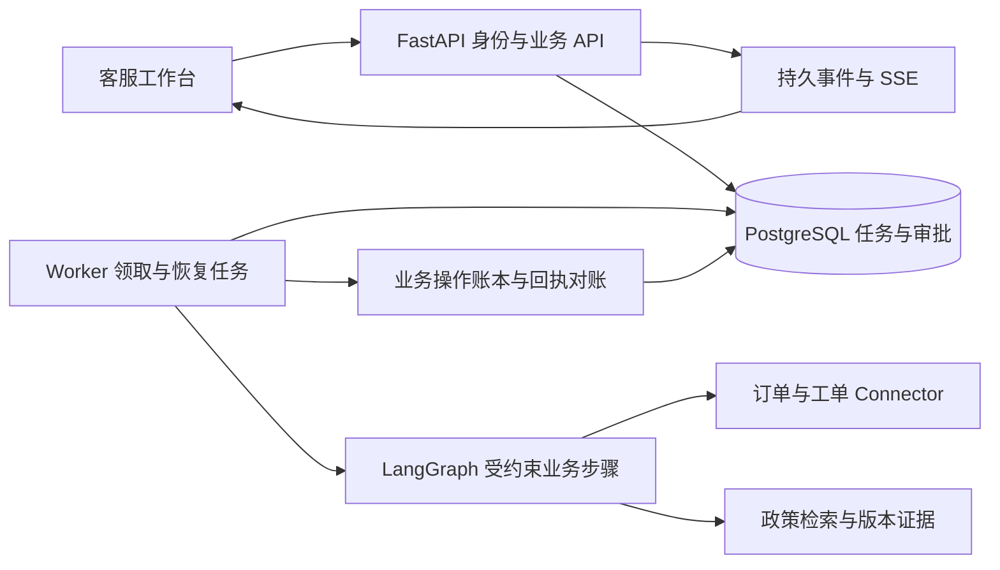

# DTC Support Agent：项目背景与实施方案

建立日期：2026-11-03。更新日期：2026-11-07。状态：分阶段实施中；售后工程候选已有隔离范围验收，生产试点方案已确认但尚未部署。

- 项目：[Lee-NG915/dtc-support-agent](https://github.com/Lee-NG915/dtc-support-agent)
- 上下文与进度：[项目 Issue](https://github.com/Lee-NG915/dtc-support-agent/issues/1)
- 当前工作分支：`codex/2-epig-after-sales`
- 上游：[JEen-wang/Adaptive-rag](https://github.com/JEen-wang/Adaptive-rag)
- 起始基线：[`2a12a62382a8c3ec033fa9a5b19b9b23b8780ab8`](https://github.com/JEen-wang/Adaptive-rag/tree/2a12a62382a8c3ec033fa9a5b19b9b23b8780ab8)

本文是本 fork 的权威规划入口，持续在同一文件维护。截至 2026-11-06，E-pig AU/US/SG 的18篇内部 demo 政策、持久审批/Worker、员工与消费者页面均已实现，真实 HTTP 八场景、特定丢响应备份恢复和独立合成浏览器四组已有范围验收。revision5回归、独立v2/v3及review规则revision7后的v4均已执行真实模型；v4 H01-H08满足冻结语义断言，H09-H12工程守卫4/4。v4 H01明确是v3 H04回归，H02-H12为运行前新写，不能把整个v4称为完全未见数据；v3残余失败保留为历史。计划80个业务任务/40个工程场景全集及独立Faithfulness固定集尚未建成，真实试用与生产未验收。Kimi全分支审查后的工程修复仍在有条件验收范围，不是项目无条件完成；最新证据和逐项裁决见[流程记录](records/after-sales/dtc-workflow.md)。较早的政策节点测试与上游数字保留在[政策记录](records/after-sales/epig-policy-v1.md)，不作为当前全项目成绩。

2026-11-07 已确认生产受控试点拓扑：E-pig 继续使用 Netlify + Neon；DTC 使用 Oracle Always Free 单机上的 API、持续 Worker 和 PostgreSQL，员工入口通过 Tailscale 私网访问，DTC 数据库每日备份到 Oracle Object Storage。生产 Compose、配置预检、Tailscale 入口说明和无推送容器构建 CI 已实现并通过本地范围验收；这不代表资源或业务已部署。Oracle 登录风控、E-pig 生产售后路由、员工凭证、备份与告警仍需完成。详见[部署与运维](11-deployment.md#生产试点方案)。

员工工作台另已增加 development/testing 专用的固定密码演示登录：密码只换取短时签名会话，角色和市场仍由服务端逐请求判定，生产环境禁止启用。页面本地候选已改为摘要优先：首屏显示下一步、客户原话和订单/金额/附件/证据关键事实，政策原文、技术标识、执行与事件按需展开；客服草稿和审批人待办按角色决定默认可见。员工端原生select/date/datetime-local也由统一的自定义可访问控件替代，checkbox和已有form controls共享设计token。工程与合成浏览器已验收，真实客服试用和效率改善仍未验证。

## 1. 项目背景与目标

DTC（Direct-to-Consumer）电商售后需要同时处理客户描述、订单与物流、退换货政策以及工单操作。拟验证的业务问题是：客服在多个页面查信息、核对条件和重复录入工单时，容易遗漏依据，也难以追踪中途失败的操作。问题的实际频率、处理时长和返工量，需要通过后续访谈与试用确认。

项目目标是提供一个可解释、可审核、可恢复的售后工作台，把一条业务请求从信息收集推进到可核验的工单结果。工程重点包括 Python 服务与 SQL、模型和工具调用、固定评测、任务可靠性、部署排障。前端承担证据展示、状态反馈和人工决策入口。

以开源项目为基础复用检索、对话和工具接口，将新增工作集中在可信身份、业务权限、持久审批、可靠执行和独立评测。所有改造通过提交、测试和运行记录说明与上游的差异，保留 [MIT 许可证及原版权声明](../LICENSE)。

首期直接使用者是企业内部客服与审批人，目标是帮助他们处理售后任务。消费者诉求作为输入材料，直接面向消费者的自动回复入口不在首期范围。

### 用户与价值假设

| 用户 | 需要完成的工作 | 后续验证方式 |
|---|---|---|
| 客服 | 查订单与政策、补充资料、核对工单草稿 | 记录处理时长、人工修改和返工原因 |
| 主管或授权审批人 | 审核写入内容，拒绝不符合规则的申请 | 检查审批对象、依据与最终执行内容一致性 |
| 维护者 | 定位失败、恢复任务、核验外部结果 | 故障演练、日志关联、恢复与对账记录 |

业务收益不预设百分比。试用前记录人工处理基线，再比较相同类型任务的质量、用时与成本。

## 2. 首期范围

首期围绕一条完整流程：**订单和物流查询 → 政策检索 → 工单草稿 → 人工审批 → 创建售后工单 → 回执核验**。

示例请求：“客户订单已签收，商品破损，希望退货，帮我检查并建立售后工单。”

1. 服务端认证客服身份，确认可访问的店铺和订单。
2. 查询订单、物流和已有工单；订单号、原因或必要凭证缺失时先澄清。
3. 检索适用政策，展示条款、版本和引用；证据不足或冲突时交人工判断。
4. 规则服务检查时间窗口、商品限制和当前订单状态；模型整理事实与建议。
5. 生成结构化工单草稿，展示拟写入字段、目标订单、业务依据及需要人工处理的问题。
6. 授权人员批准或拒绝。审批等待可跨服务重启，修改草稿后旧审批失效。
7. 执行前再次校验身份、审批和业务条件，创建工单并记录外部回执。
8. 读回确认实际结果，展示工单编号和审计轨迹；无法判定结果时转入待对账。

| 首期包含 | 首期暂不包含 |
|---|---|
| 政策问答、订单与物流只读查询 | 消费者自动回复入口、全品类商城、营销与选品平台 |
| 工单草稿、审批、创建工单、结果查询 | 实际支付退款、自动取消订单等其他业务写操作 |
| 合成数据、Fake Connector、隔离测试系统适配 | 默认接入任何公司的真实店铺或客户数据 |
| 持久任务、受控重试、去重、回执对账 | 对任意第三方系统承诺 exactly-once |
| 单套 Agent 流程、现有检索能力、固定评测 | 模型微调、多 Agent 团队、通用工作流搭建器 |
| Docker Compose、API 与 Worker、PostgreSQL | 首期引入 Kubernetes、Kafka 或多套任务框架 |

上游已经存在其他工具；DTC 首期流程将使用显式工具白名单，仅开放约定的查询与工单写入能力。保留上游代码不意味着向新流程开放所有操作。

## 3. 起始版本核查与改造边界

以下是起始基线的静态核查，不替代运行验收；后续实现更新时，应同步维护本节状态及对应使用文档。

| 领域 | 基线现状与代码入口 | 本 fork 计划增量 |
|---|---|---|
| API 与身份 | [请求 Schema](../app/schemas/chat.py) 包含客户端 `user_id`；[路由](../app/api/routes/chat.py) 将请求传给服务，现有文档也列出未验证身份的限制 | 服务端身份与店铺成员关系；订单、任务、审批、事件均按权限访问 |
| 人工确认 | [ChatService](../app/services/chat_service.py) 将待确认动作保存在 `_pending_actions` 进程字典 | 数据库审批记录，绑定具体动作与版本，支持拒绝、失效和重启恢复 |
| Graph | [Graph 构建](../app/agents/graph.py) 使用 `graph.compile()`，未配置持久 checkpointer | 持久任务与执行检查点；将可恢复步骤和外部副作用分别管理 |
| 幂等 | [幂等仓储](../app/repositories/idempotency.py) 已有键、参数指纹与结果缓存 | 增加执行占用、并发约束和业务操作账本；验证外部成功、本地失败的情况 |
| 数据与部署 | [数据库初始化](../app/repositories/db.py) 使用 `create_all`；[Alembic 版本](../alembic/versions/) 已存在 | 部署前显式迁移，验证空库安装、旧库升级与恢复 |
| 业务数据 | [演示数据](../app/services/seed.py) 与订单仓储提供本地订单/物流；[限制说明](12-limitations.md) 列明无承运商集成 | 定义订单与工单 Connector，先实现合成数据和可控故障，再接隔离测试系统 |
| 检索与界面 | 已有 [检索模块](../app/retrieval/)、[工具接口](../app/tools/) 和 [React 前端](../frontend/) | 保留可复用实现，补政策版本、工单详情、审批和任务轨迹 |
| 评测 | [上游报告](../eval/MEASURED.md) 与 [数据集](../eval/dataset/) 已存在；报告说明部分原始 JSON 不随仓库分发、生成评分采用同模型裁判 | 自建售后样例、保留集、人工评分与可复算报告；重新测量本 fork |

当前代码有确认和幂等基础，但跨进程恢复、真实身份与外部写入一致性仍需专门实现和验证。上游报告中的通过数、准确率和延迟不能直接填入本 fork 的验收结果。

## 4. 模型、规则与人工职责

| 角色 | 负责 | 执行边界 |
|---|---|---|
| 模型 | 意图理解、参数提取、受约束的只读工具选择、证据整理、草稿建议 | 输出必须通过 Schema 与业务校验；不决定身份、权限或最终写入授权 |
| 规则服务 | 订单归属、日期与金额计算、政策适用条件、工具白名单、状态迁移、去重 | 确定性逻辑有单元和集成测试；数据库访问由业务接口封装 |
| 人 | 补充资料、核对草稿、批准写操作、处理政策例外与证据冲突 | 必须具备对应权限；审批和人工修改都保留记录 |

模型无法从任意政策自然语言中可靠地产生全部业务规则。首期使用版本化的演示政策与人工维护的规则配置；不确定条款转人工处理。输入文本、检索材料和工具返回内容均不能覆盖权限或触发未审批的写入。

## 5. 目标架构与代码落点

沿用现有目录与 FastAPI、LangGraph、React 技术基础。一个 Python 后端代码库，API 与 Worker 分进程，共用 PostgreSQL；现有检索后端按实际配置使用。首期不为规划重排整个仓库。

图中 Worker、持久审批、回执对账与事件重放属于拟新增能力。

| 目录 | 责任及计划 |
|---|---|
| `app/api/`、`app/schemas/` | 认证上下文、任务/审批/结果接口、Pydantic 校验；具体路由在实现 Issue 中确定 |
| `app/services/` | 工单业务规则、审批和执行协调；不在路由中直接操作外部系统 |
| `app/agents/`、`app/retrieval/`、`app/tools/` | 保留现有组织，补业务参数、政策版本和受控调用 |
| `app/repositories/`、`alembic/` | ORM、事务、唯一约束、迁移与恢复 |
| `app/connectors/`（拟新增） | 订单与工单接口、Fake/测试适配器、错误分类与回执查询 |
| `app/jobs/`（拟新增） | 作业领取、租约、执行检查点、有限重试和对账 |
| `frontend/` | 查询结果、引用、草稿、审批、任务进度和失败处理 |
| `tests/`、`eval/` | 工程正确性测试与模型效果评测分别维护 |

### 数据与事务

逻辑记录包括：用户/角色与店铺成员关系、订单快照、任务、执行步骤/检查点、审批、业务操作、工单结果、任务事件、评测运行。实际表结构在实现时确定，不以表数作为目标。

- 任务、审批、操作账本均有服务端主键和店铺范围；关联对象必须属于同一可访问范围。
- 请求幂等键按身份、店铺和操作类型限定作用域；同键不同参数返回冲突，不复用旧结果。
- 一次业务请求拥有稳定操作标识，审批、重试和恢复沿用该标识；同一订单不同售后事项不能被错误合并。
- 任务入队与初始事件在同一数据库事务提交；Worker 从持久记录领取，避免内存通知丢失。
- 本地事务不跨外部网络调用长时间持锁；外部写入通过操作账本和回执协调，不能依赖一次 SQL 回滚撤销外部结果。

### 身份与审批

服务端验证会话或签名令牌，再从成员关系确定角色及店铺范围。演示身份仅在显式测试配置下启用，不能把客户端提交的 `user_id` 当作认证。审批权限与发起权限分开；演示可提供客服与主管两个角色。

审批至少绑定：任务、申请人、审批人、店铺/订单、工具名、规范化参数摘要、订单与政策版本、有效期、状态和时间。批准接口采用条件更新防止并发重复批准；草稿、政策或关键订单状态变化时旧批准失效，执行前重新校验并按需再次审批。

### 任务状态与恢复

拟采用主路径：`queued → running → waiting_approval → queued → running → succeeded`。其他状态为 `failed`、`cancelled`、`reconciliation_required`；只有服务端可以执行合法迁移。对账完成后记录已确认结果，或在确认未执行且业务条件仍满足时重新排队。

持久任务记录作为业务状态入口；Graph 的检查点只记录执行位置和必要中间结果。实现持久 checkpointer 时必须关联同一 `task_id`，在恢复边界检查业务状态与操作账本，避免两个状态来源各自推进。数据库领取任务使用租约及执行版本，迟到 Worker 不能覆盖新持有者的结果。

检查点回答“继续到哪一步”，操作账本回答“是否已产生外部效果”。恢复执行始终先检查操作账本，再决定能否调用写工具。

### 外部写入与对账

外部系统支持幂等键时，所有重试使用同一个稳定业务操作键；支持按业务标识查询时，先查回执再决定是否重发。外部已成功而本地未保存，或网络超时导致结果未知时，进入 `reconciliation_required`。

不支持幂等和结果查询的系统，未知结果交人工核验，不能自动重复写入。Worker 租约只保护本地协调，不能阻止已发出的外部请求；外部幂等或人工对账仍然必要。取消和拒绝也不能声称撤销已完成的外部操作。

模型超时、429 和可重试错误采用次数与时间上限；参数错误、权限拒绝、业务规则不满足分别处理。SSE 只传递已记录事件，使用任务内递增序号支持重连补发，浏览器断开不取消业务任务。

## 6. 数据、连接器与部署边界

先准备公开可运行的合成订单、物流、政策与工单数据，覆盖正常、过期、缺资料、状态变化和重复申请等情况。Fake Connector 应支持注入超时、限流、外部成功后响应丢失等故障，与真实适配器使用一致接口。

后续接入开发店铺或测试系统前，确认访问范围、测试账户、工单接口权限、幂等能力及回执查询方式。未取得条件时继续完成 Fake Connector 和故障验证，不虚构真实对接成果。

生产受控试点采用两套独立运行边界：

- E-pig 的消费者页面和 Route Handlers 继续运行在 Netlify，业务数据继续使用 Neon PostgreSQL。DTC 通过 HTTPS 和 service token 调用 E-pig，不共享数据库。
- DTC 在 Oracle Always Free 单机用 Docker Compose 启动 API、持续 Worker、本机 PostgreSQL 与迁移 gate；块存储和每日 `pg_dump` 备份分别负责运行数据与恢复。员工入口通过 Tailscale 访问，API/数据库不开放公网端口。

不把 E-pig 迁到 Oracle，也不把当前 Python ASGI/Worker 直接改写成 Netlify Functions。前者的迁移没有业务收益，后者是后端重写而非部署工作。若未来要求高可用、固定 SLA、跨区容灾或更大容量，需重新比较托管 PostgreSQL、Cloudflare Zero Trust 或独立云资源，不能由当前免费单机方案自动满足。

迁移必须在 API/Worker 启动前显式执行。生产文档必须覆盖环境模板、E-pig 入口验收、员工凭证开通/轮换/停用、健康检查、依赖故障定位、备份恢复、升级、回滚和紧急停用。密钥不入库；日志不保存认证令牌和完整客户资料，通过 `trace_id/task_id/operation_id` 关联排障。固定密码演示登录、Fake Connector、HTTP E-pig 地址和空 SKU 映射不得进入生产。

当前可运行方式仍以 [现有快速开始](02-getting-started.md) 为准；隔离演示入口见[部署与运维](11-deployment.md)。生产 Compose、Tailscale 入口、备份调度和员工凭证 CLI 是计划或待实现项，不能把现有 Compose 描述为已经部署。

## 7. 评测与验收设计

### 固定样例与版本比较

建议逐步建立 **80 个业务任务与 40 个工程验收场景**。这是完整计划规模，尚未建成。当前 E-pig 有 34 条离线政策开发样例和 12 例真实模型保留子集，已覆盖部分完整图/Faithfulness 路径、草稿及工程故障守卫；不能外推为全集通过或独立 Faithfulness 质量验证。此前 Koala 样例仅为历史：

- 业务任务：30 个政策/多条件问题、20 个订单物流查询、20 个工单任务、10 个信息不足需澄清问题。
- 按类别划分 50 个开发样例、30 个保留样例。调参只看开发集，正式比较使用同一保留集。
- 工程场景：身份隔离、审批竞争、重试重复请求、崩溃与回执异常四类各约 10 项。
- 样例包含输入、身份与店铺、订单/政策快照、预期行为、禁止动作及评分依据；固定版本，不删除失败样例美化结果。

先复现并记录起始版本，再建立新业务流程的最小基线；只有两个版本均支持的任务才做直接提升比较。新增加的审批与恢复能力单独报告工程验收，不把旧版不支持的任务算成检索质量提升。模型、提示词、知识、连接器数据与采样配置均随报告记录。

| 指标 | 口径 |
|---|---|
| 任务成功 | 完成预先定义的业务结果；返回一段文字不等于成功 |
| 引用正确 | 引用存在、版本适用且确实支持结论；与检索命中率分开 |
| 工具正确 | 工具选择、参数、目标订单和是否应调用均符合预期 |
| 写入完整性 | 无越权、无未审批执行、无重复业务结果；核对数据库与外部回执 |
| 人工采用/修改 | 只统计实际试用者的选择，不能用模型评分代替 |
| 延迟与成本 | 端到端及模型/检索/工具分项，人工等待单列；重试、Embedding、Judge 成本分列 |
| 失败分类 | 检索漏召回、政策误用、参数错误、权限错误、重复执行、外部结果未知、模型输出错误 |

人工评分使用正确性、依据充分性、可执行性三个维度，各自定义 0/1/2 的样例锚点。自动 Judge 先与人工复核对比，再确定适用范围。报告展示分子/分母、运行环境与失败案例；质量和性能目标在基线建立后确定。

### 必须通过的工程场景

| 编号 | 场景 | 通过标准 |
|---|---|---|
| A1 | 伪造身份、跨店铺查订单或读取任务事件 | 服务端拒绝，不返回受限数据 |
| A2 | 缺少参数、非法 JSON、不存在或冲突的政策证据 | 明确校验/澄清/转人工，不生成无依据的写操作 |
| A3 | 双击提交与并发请求 | 同键同参数返回同一任务；同键不同参数冲突 |
| A4 | 审批等待时重启 API/Worker | 审批可查询、可继续，身份和审批对象不丢失 |
| A5 | 无权限、过期、拒绝后的审批及并发批准 | 不执行未授权动作；同一审批只产生一次有效状态迁移 |
| A6 | 批准后修改草稿或订单/政策版本变化 | 旧批准不能执行已变化的动作，重新检查或审批 |
| A7 | 两个 Worker 竞争、租约到期和迟到回写 | 有效领取者推进状态；旧执行者不能覆盖结果 |
| A8 | 外部已创建工单、本地保存前崩溃 | 查询或幂等重试恢复同一回执，最终只有一份业务结果 |
| A9 | 外部无幂等且无法查询，写入结果未知 | 停止自动重发，进入人工对账，有清晰操作记录 |
| A10 | 模型超时/429、网络错误 | 有限重试并分类记录；不重复业务写入 |
| A11 | SSE 断线重连 | 任务继续，按事件序号恢复展示，不漏最终结果 |
| A12 | 干净部署、数据库升级与备份恢复 | 按文档完成迁移和启动，恢复后能核对任务与工单记录 |

权限、未审批写入和重复执行属于阻断验收的问题。测试通过表示已覆盖场景满足要求，不承诺所有现实环境下零故障。

## 8. 分阶段推进

阶段按验收产物推进，不预设固定发布日期。每周约 10～15 小时投入时，可将 M1～M6 作为约六周的初始估算；基线跑通后再调整。

| 阶段 | 工作 | 退出条件 | 当前状态 |
|---|---|---|---|
| M0 背景与方案 | 固定上游基线、范围、架构、验收与协作方式 | 文档、Issue、关联开发分支已提交且远端可读取 | 完成：规划、技能和跨仓权威文档已建立 |
| M1 复现与需求 | 跑通原仓，梳理调用链，确认首期政策和工单字段 | 基线运行记录、10 个种子案例、差距清单 | 合成范围已有隔离基线、18篇demo政策、来源/品牌运行时、固定样例与差距记录；没有真实客户访谈/试用证据 |
| M2 身份与数据 | 认证授权、Connector、业务 API、事务和迁移 | 负向权限测试、Fake 数据、空库安装和升级验证 | E-pig持久运行时/HTTP/真实PG与DTC-2a身份/Connector已验收推送；DTC-2b持久数据及两仓真实HTTP八场景已独立验收，页面闭环另验 |
| M3 完整业务流程 | 查询、证据、规则、草稿、持久审批、工单 UI | 在测试连接器中走通人工审批后的工单创建 | 草稿/证据/持久审批已本地范围验收；Worker核心与真实HTTP提交后崩溃恢复已范围验收；员工证据/建议后端已验收，员工UI与消费者页面已通过独立合成浏览器人工审批闭环、权限/冲突/窄屏验收，非真实客户试用 |
| M4 可靠执行 | Worker、恢复、幂等、回执对账、事件重放 | A3～A11 的相关故障与并发场景通过 | Worker/有界轮询/恢复及专用PG入口已通过本地范围验收；真实HTTP提交后崩溃恢复已范围验收；六故事及两项驳回扩展已通过真实HTTP/DB独立验证，故障UI另验 |
| M5 评测与优化 | 固定数据集、保留集、人工评分、版本对比 | 可复算报告及一次有依据的优化，列明剩余失败 | 34条离线政策开发集、revision5回归、v2/v3及revision7后的v4均执行并人工裁决；v4模型H01-H08满足冻结断言、工程4/4，其中H01是v3失败回归、H02-H12新写；80/40全集、独立Faithfulness与生产准确率未测 |
| M6 试用与交付 | 干净部署、操作手册、小范围试用、反馈迭代 | 部署/恢复记录、实际试用反馈、完整演示 | 已确认 Netlify + Neon / Oracle 单机 + Tailscale 生产试点方案和上线闸门；生产 Compose、配置预检、Tailscale 说明和容器构建 CI 已本地验收。Oracle 认证受风控阻塞，E-pig 生产入口、员工凭证、备份告警与发布闸门未完成，未执行真实试用/生产部署 |

M1 即建立评测样例；M2～M4 随实现补测试，不等到 M5 才验证。M3 的可运行版本可开始收集试用反馈；M6 的真实试用取决于用户资源，无试用时如实记录为演示验收。

### 2026-11-06 执行顺序与交付门槛调整（用户已确认）

保留 M0～M6 的业务范围及验收 ID，按下表组织后续开发窗口。窗口是执行顺序，不是另一套里程碑，也不重写已经完成阶段的真实执行记录。目标先达到可复现的面试展示和隔离试点条件，企业生产可用需另有运行、容量、安全与运维证据；不能仅凭测试数或架构描述宣称达标。

| 顺序 | 对应原阶段 | 工作和退出条件 | 当前状态 |
|---|---|---|---|
| 1 基础验证与接入 | M2、部分 M4/M6 | 在隔离真实 PostgreSQL 用多连接验证竞争、回滚、订单版本和回执；显式迁移、adapter 切换、HTTP 集成；修复技能环境并确认 CI 实际运行 | 真实PG多连接、5d显式运行时/迁移/真实HTTP与重启均已验收推送；修复后的E-pig CI42081613637实际通过。DTC push CI42184894521与PR CI42184900472四任务均成功 |
| 2 最小业务闭环 | M2～M3 | 单市场合成订单，完成 DTC 员工角色/市场、Connector、持久同步游标/去重、草稿、持久人工审批、稳定操作键及建单回读；至少以 API 走通正常故事 | 2a身份/Connector已推送；2b持久同步、证据/草稿、审批与prepared操作已本地验收，2c建单/恢复核心已通过Fake/真实PG范围验收，真实HTTP恢复已验收，页面完整旅程另验 |
| 3 最小可用页面 | M3 | 消费者申请/附件/进度，客服队列/详情和审批入口；可通过页面完成闭环，权限/加载/失败/冲突均有可见行为 | E-pig消费者页面已推送72f1621并有工程验证；DTC员工工作台工程候选已推送，真实Chromium合成角色旅程已独立通过，桌面插件通道未验证 |
| 4 异常与恢复 | M4 | 补齐 Worker/租约、重启恢复、审批失效、未知结果对账、游标及事件恢复；六个核心故事均有实际证据 | 八场景真实HTTP/DB与特定备份恢复已独立验证；页面未知结果/409/角色等组已独立通过；实际容量/生产仍未测 |
| 5 完整 AI 与业务评测 | M1、M5 | 固定开发/保留集，完整图与工具选择/引用/转人工、人工评分、失败分类及可复算对比；同时验证 UI 可访问性和容量预算 | revision7后v4真实执行，模型H01-H08均满足冻结断言、工程4/4；H01为v3残余回归，H02-H12运行前新写。页面已独立验收；80/40全集、独立Faithfulness、容量压测与生产SLA未测 |
| 6 部署、试用与学习交付 | M6 | 干净安装升级、备份恢复、基础日志/监控、操作手册、演示脚本和关键源码讲解；无真实试用时只称演示验收 | 生产试点拓扑和[上线前闸门](11-deployment.md#上线闸门)已确认；生产 Compose/预检/Tailscale说明/容器构建CI已本地验收；DTC部署基础、两仓空feed及丢响应备份恢复已独立验证，独立合成页面演示已验收。Oracle风控、E-pig生产售后入口、员工凭证、备份告警与实际部署未完成，真实试用、生产和容量SLA未测 |

六个核心故事及既有验收映射只在[产品蓝图](architecture/modules/after-sales/product-blueprint.md#131-六个核心验收故事)维护；它们覆盖正常、缺证据、越权、陈旧批准、丢回执和重启。不可仅凭 E-pig 子系统通过就勾选完整跨仓故事。E-pig 本仓细分任务与实际证据见[原实施计划](https://github.com/Lee-NG915/E-pig/blob/after-sales/agent-integration/docs/engineering/after-sales-agent-integration.md)，DTC#2 跟踪整体。

每次验收分别列出以下证据，不互相折算：单元/纯逻辑、PGlite 真实 SQL、独立 PostgreSQL 多连接、真实 HTTP 集成、浏览器完整旅程、完整 AI 固定评测、部署/恢复、实际用户试用。记录候选版本、环境/合成数据、实际命令、通过/失败/跳过、日志或报告位置和未测范围。历史通过与当前候选分开；临时日志不是长期可取得证据，需能重跑或按证据规范归档。旧失败不删除，评测集不为通过而删例。

窗口1实施前明确隔离数据库目标、迁移/清理范围和测试超时；试点前明确预期数据规模、并发/到达速率、轮询频率、性能测量方法及恢复时间/可接受数据损失目标。日志、审计和附件的保留/删除责任及期限也须在试点前确认，不能由 demo 过期时间代替；不裁剪 v1 feed 历史。沿用产品蓝图已有性能预算作为待测假设，不另承诺 SLA，不从未运行的压测推导成绩。

每窗口学习交付按现有[学习路线](learning/README.md)持续补：一个业务问题、一条真实源码调用链、关键取舍、可复现失败与小实验、预期/实际结果、自检问题。面试材料只使用已验证事实；上游复用、本 fork 新增、合成场景和真实反馈分别说明。保留 Python API + Worker/PostgreSQL 与现有前端分层；没有实际场景和测量依据不引入微服务、消息队列、多 Agent 或通用审批平台。

## 9. 依赖、待确认事项与风险

| 事项 | 初步处理 | 需要确认的节点 |
|---|---|---|
| 首期业务政策与工单字段 | 先用合成数据建立固定口径 | M1 与目标使用者核对样例及人工验收标准 |
| 模型/Embedding 服务与预算 | 优先沿用可用 Provider，记录降级情况 | 运行付费评测前明确配置、价格与预算 |
| 外部测试系统 | Fake Connector 先行 | 接入前确认授权、权限、幂等与回执能力 |
| 持久检查点与业务状态协同 | 任务记录为业务入口，恢复先查操作账本 | M4 先做最小故障实验，确认后固化实现 |
| 试用用户 | 计划邀请 3～5 位有售后处理经验的使用者 | 具备可用版本后确认参与和数据范围 |
| 上游依赖/接口演进 | 固定起点，按需审查上游变化 | 升级单独记录差异和回归，不混入当前文档提交 |

## 10. 协作与交付记录

- 项目 Issue 保存背景、里程碑、阻塞和验收入口；后续具体实现可拆分关联 Issue，不复制多份权威方案。
- [售后产品蓝图](architecture/modules/after-sales/product-blueprint.md)是跨仓库产品行为唯一正本；[E-pig 对接规范](architecture/modules/after-sales/epig-contract.md)与 `contracts/epig-after-sales/v1/` 固定线上契约、共享样例和版本变更门禁，跨仓进度由 Issue #2 跟踪。
- [E-pig 内部演示政策包与市场隔离检索](architecture/modules/after-sales/epig-policy.md)记录当前政策边界；[对应验证记录](records/after-sales/epig-policy-v1.md)区分计划、实现、离线/真实模型验证和生产批准状态，具体进度由 Issue #3 跟踪。[Koala 历史说明](architecture/modules/after-sales/koala-policy.md)仅用于追溯。
- 开发分支采用 `codex/<issue-number>-<topic>`，提交引用实际 Issue。当前分支承载售后契约、E-pig 政策增量及既有规划文档，项目 Issue 保持开放跟踪后续实施。
- 本文件记录最新方案；实现、测试和试用结果在原主题下持续更新，历史事实使用提交与 Issue 评论追踪。
- 对外说明区分“上游复用”“本 fork 新增”“实际验证结果”；不使用上游作者的指标、用户规模或上线经历作为个人成果。
- 后续交付材料包括运行入口、合成数据、架构及权限说明、故障演练、评测报告、试用反馈和排障手册。文档证据使用相对路径或仓库链接，不依赖本地截图编号。

- [Codex 方案与验收、Claude 实现协作规范](guides/ai-collaboration.md)是后续 AI 分工唯一正本：当前 Codex 负责文档、方案、开发/测试计划、Review、验收验证与最终验收，Claude 负责实现和必要的单元测试；2026-11-05 本次用户调整起生效，不回溯改写历史记录。

开发助手按 [技能指南](guides/skills.md) 工作，文档遵循从 Hextech 适配的 [文档规范](guides/documentation.md)。初学者从 [学习路线](learning/README.md) 进入，先跟踪真实请求，再逐步做接口、审批、恢复与评测；技术词汇随业务例子解释。技能和文档接入的实际验证维护在 [同主题记录](records/workflows/skills-and-docs.md)。

后续以当前CR修复、模型质量残余和未覆盖验收要素为优先；M1合成基线、部分完整图与跨仓旅程已有证据，独立Faithfulness全集和真实试用仍待推进。开发分支的合成验收不代表售后工作台或演示政策已进入生产。

### 自主交付与环境准备（2026-11-06）

用户已授权Codex自主推进后续计划，各章Review/剃刀检查/验收通过后提交推送并同步证据，职责和权限只在[协作正本](guides/ai-collaboration.md#6-自主项目推进与环境边界2026-11-06用户确认)维护。

本轮只读预检：GitHub登录可用；E-pig项目Node24/pnpm10.34.5可用；Docker CLI已安装但daemon无法连接；DTC当前shell找不到uv、系统Python3.9低于项目要求，虽存在.venv路径但本轮未验证可执行性；E-pig技能源软链缺失仍是既有verify环境阻塞。已有Compose使用SQLite单API，不能当作目标API/Worker/Postgres部署。既有外部PG测试读取.env.local，不复用其凭据去执行新的隔离测试。

下一章先收敛工具、隔离PG和技能来源，明确容器/数据清理边界；不以修改doctor或伪造SKILL.md消除失败。真实模型固定评测需要另行确认累计预算与Provider/模型；无预算时继续Fake/离线验证。最终部署与真实用户试用到相应窗口再明确目标/资源/权限，不阻塞当前本地开发。

第一章环境执行补充（2026-11-06）：Docker已启动并下载专用Postgres16镜像；uv和Python3.12已安装，`uv sync --frozen --extra dev --python 3.12`成功。Codex实际运行锁检查、Ruff格式/静态、mypy（125文件）及pytest均通过，**242 passed**，4条依赖弃用/转义警告保留。E-pig技能源恢复后agent-doctor已PASS，无doctor绕过。此处是工具/离线工程环境验证，不代表真实PG并发或跨仓验收。

文档提交会推进DTC跟踪源：E-pig现有sync检查器硬编码源提交，需同批显式更新允许源、通过sync重新生成source-lock并检查51文件逐字节/digest不变，随后运行check/freshness和对应负例。不是线上契约变更，不修改OpenAPI/fixtures语义；Issue交接区分旧不可变契约内容基线与新的锁定来源，不能静默手改vendor或把陈旧警告当通过。

第一章范围验收更新（2026-11-06）：E-pig专用真实PG多连接、回滚与取消清理测试已由Codex独立运行通过，普通verify也已恢复全绿；具体版本、计数和失败/返工保留在E-pig原实施计划，不能外推为HTTP、运行时切换或跨仓全旅程通过。文档Review修正了导航中“vendor未完成”的旧状态，保留既有学习/政策未提交内容。后续先做5d显式迁移与adapter接入，再转向DTC最小闭环与页面。

CI补充（2026-11-06）：Claude最小增加当前DTC开发分支push触发，原main/PR/dispatch、contents:read及检查步骤均保留，无部署。Codex核对配置与语法通过，远端是否触发及通过须在推送后实际确认；不以修改触发器代替CI结果。

2026-11-06当前实施入口：[DTC持久业务流程设计](architecture/modules/after-sales/dtc-workflow.md)按2a身份/Connector、2b持久草稿审批、2cWorker恢复拆分，复用本计划里程碑与产品状态机。2a/2b/2c与E-pig5d已分别交付并范围验收；员工后端已交付，员工页面仅工程候选有条件通过。方案Review补齐未派遣prepared安全失败退出和旧同步页防倒退，属于内部流程语义澄清，不改变E-pig线上字段/枚举。当前对话用户再次确认Codex管理/验收、Claude auto实现。

5d远端交付更新（2026-11-06）：E-pig运行时提交5d6cb6e及CI隔离修复fe15a99已推送，[CI42081613637](https://github.com/Lee-NG915/E-pig/actions/runs/42081613637) quality/after-sales-postgres均成功，deploy skipped。精确证据/失败历史只在E-pig原实施记录维护。消费者订单页组件开始实现；DTC-2a已验收推送d3cab38，2b持久业务候选Review返工中，2cWorker与完整跨仓故事仍未完成。

2026-11-06评测安全与CI增量：默认评测显式离线、不读取应用.env、不复用既有业务库；真实Provider需显式开关与有限调用预算。已完成本地覆盖率验证535 passed、4 skipped、80.89%；CI定义补前端与专用PG检查，远端运行另验。此项不代表M5完整业务质量、保留集或M6部署完成，交付状态见流程记录。

工具轨迹增量与保留集（2026-11-06，候选待交付）：实际Tool.run名/参数/次数已完成离线CLI验证；不是关键词推断。12条独立保留样例已由验收侧准备并冻结app/知识，6政策图+2建议+4工程守卫分列，尚未运行，不填准确率；冻结清单与限制见评测指南。
